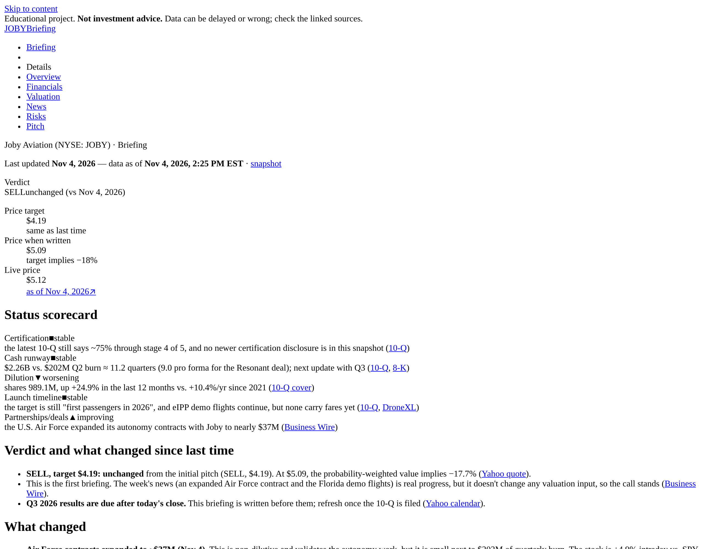
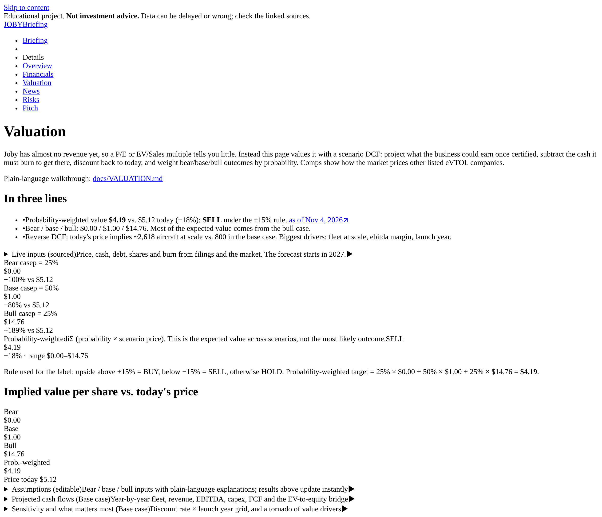
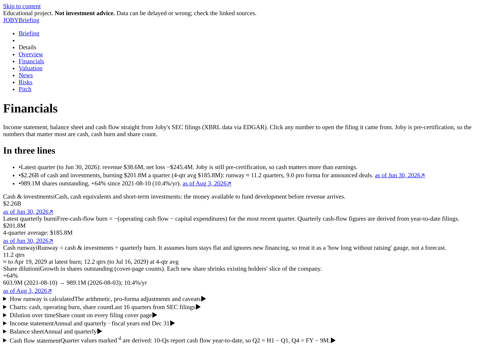
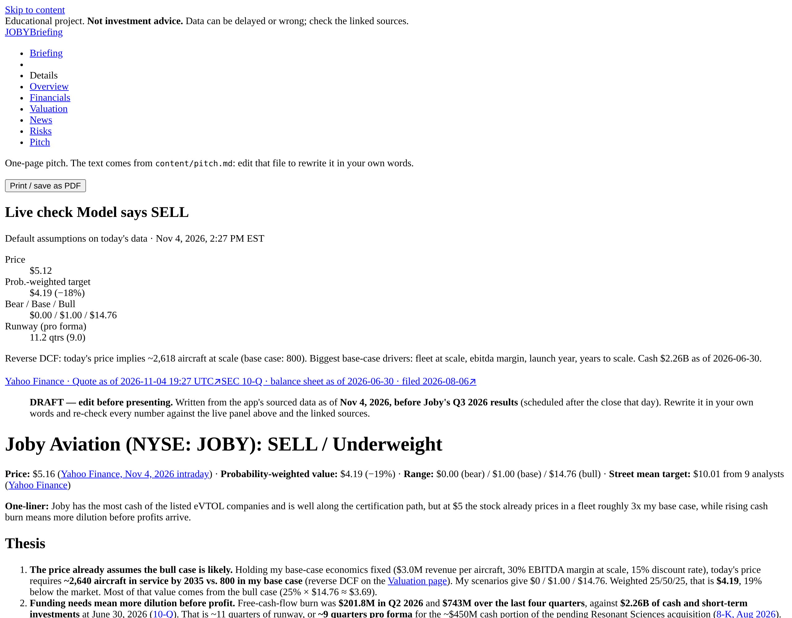
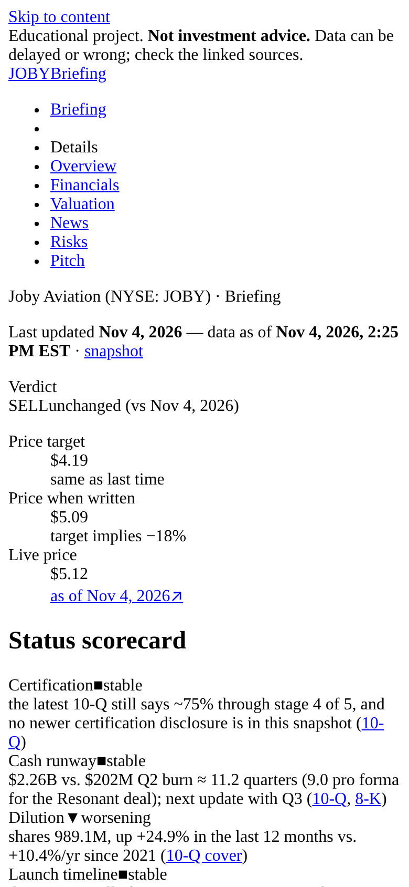

# JOBY Stock Pitch Builder

A web app that builds a complete, sourced investment pitch on **Joby Aviation (NYSE: JOBY)**, a pre-revenue eVTOL air-taxi company. It pulls live data from SEC EDGAR, Yahoo Finance and Google News, values the company with an interactive scenario DCF, and produces a one-page, printable pitch. Every number links to its source and date. If a source is down, the app says so instead of guessing.

> **Educational project, not investment advice.**

**Briefing (home page).** `/` shows the current call: verdict, price target, a status scorecard, what changed, upcoming events and things to watch. The text is written by a Claude Code session in [`content/briefing.md`](content/briefing.md), citing only [`data/snapshot.json`](data/snapshot.json). The other tabs are the live "Details" behind it.

**Refreshing.** Say *"refresh the Joby briefing"* to Claude Code. It follows [docs/REFRESH.md](docs/REFRESH.md): `npm run snapshot`, compare with the last briefing, change [assumptions](content/assumptions.json) only with logged evidence, rewrite the briefing, archive a dated copy in `content/briefings/`, run `npm run briefing:check`, lint, tests and build, then push to `main`. No API keys are used.



| Valuation | Financials | Pitch | Mobile (dark) |
| --- | --- | --- | --- |
|  |  |  |  |

## Why this was hard

Valuing Joby was much harder than valuing a typical company, because it doesn't make money yet. Normal tools like the P/E ratio, revenue multiples or a DCF built on today's cash flows don't work when there are no earnings to start from. I had to evaluate it with completely different metrics:

- **Cash runway:** how many quarters Joby can keep operating before it needs more money
- **Cash burn and dilution:** how fast it spends, and how much existing shareholders get diluted when it raises more
- **Certification milestones:** how close it is to FAA approval to fly paying passengers
- **Future fleet economics:** a bear/base/bull model of how many aircraft it could fly and what each one could earn
- **What the price assumes:** a reverse DCF asking how big Joby must get to justify today's stock price

## Key findings (snapshot: Nov 4, 2026, before Q3 2026 results)

- **The price assumes a big fleet.** At ~$5.16, a reverse DCF holding my base-case economics fixed needs **~2,640 aircraft in service by 2035** vs. 800 in my base case. My probability-weighted value is **$4.19 (−19%) → SELL by a disclosed ±15% rule**. Price from [Yahoo Finance](https://finance.yahoo.com/quote/JOBY/); model on the Valuation page.
- **Cash buys ~2–3 years, but dilution continues.** $2.26B of cash and short-term investments against $202M of Q2 free-cash-flow burn is **~11 quarters of runway**, or ~9 pro forma for the ~$450M cash portion of the pending Resonant acquisition ([10-Q](https://www.sec.gov/Archives/edgar/data/1819848/000181984826000435/joby-20260630.htm), [8-K](https://www.sec.gov/Archives/edgar/data/1819848/000162828026055505/joby-20260808.htm)). The share count is **up 64% since Aug 2021**, and a $750M at-the-market program is in place ([424B5](https://www.sec.gov/Archives/edgar/data/1819848/000162828026055507/atm424b5.htm)).
- **Certification is close but not done.** Joby reports being ~75% through stage 4 of 5 of FAA type certification and targets first passengers in 2026 ([10-Q](https://www.sec.gov/Archives/edgar/data/1819848/000181984826000435/joby-20260630.htm)). The most valuable assumptions are **fleet at scale, margin, launch year and ramp speed**.

## Pages

0. **Briefing** (`/`): verdict, scorecard, what changed, events timeline, things to watch; warns when the data is more than 14 days old.

Details pages, each led by a live 3-line summary with long tables and charts in collapsible sections:

1. **Overview**: snapshot in the company's own words, price chart (1M/1Y/5Y/Max), market cap, shares, 52-week range, runway.
2. **Financials**: income statement, balance sheet and cash flow from EDGAR XBRL (annual and quarterly), with charts of cash, burn and share count; runway and dilution math shown.
3. **Valuation**: editable bear/base/bull DCF, probability-weighted target, sensitivity grid, tornado, reverse DCF, live comps. See [docs/VALUATION.md](docs/VALUATION.md).
4. **News & Catalysts**: tagged news timeline, earnings date, dated milestones from filings, recent 8-Ks.
5. **Risks**: seven risk themes built from the latest 10-K Risk Factors, live data and headlines.
6. **The Pitch**: one page rendered from [`content/pitch.md`](content/pitch.md) (labeled DRAFT) beside a live check panel; print/PDF-ready.

## Run it

```bash
npm install && npm run dev
```

Open http://localhost:3000. No API keys are needed. Optionally set `SEC_USER_AGENT="Your Name you@example.com"` (see `.env.example`); the SEC asks automated clients to identify themselves.

```bash
npm test            # unit tests: DCF, probability weighting, runway, dilution, parsing, snapshot, briefing
npm run lint
npm run build
npm run snapshot          # fetch fresh data into data/snapshot.json
npm run snapshot:check    # validate it (sources, dates, 60-day news window, staleness)
npm run briefing:check    # lint content/briefing.md; every URL must be in the snapshot
```

Deploy: import the repo into Vercel (free tier) with no configuration. Set `SIMULATE_OUTAGE=all` (or `sec`, `yahoo`, `news`) locally to see how each page degrades when a source is down.

## Tech stack

Next.js 16 (App Router, Cache Components) · TypeScript · Tailwind CSS v4 · Recharts · `yahoo-finance2` · SEC EDGAR JSON APIs · Google News RSS (`fast-xml-parser`) · `react-markdown` · Vitest · Playwright (screenshots)

## Design choices

- **Primary sources first.** Financials come from SEC XBRL, not a data vendor. Quarterly cash flows are derived from year-to-date filings (Q2 = H1 − Q1) and flagged in the tables.
- **Caching.** Each data source is cached for about an hour (`use cache` + `cacheLife`), and pages stream data in at request time. Errors are never cached, and the build needs no network access.
- **Assumptions are mine and labeled.** Each one has a plain-language tooltip explaining why it matters. Live inputs (cash, debt, shares, burn, price) are sourced and cannot be edited.
- **Pending deals.** The Resonant acquisition is treated as value-neutral in the DCF and only reduces cash in the pro-forma runway. The adjustment is curated in `src/lib/adjustments.ts` with its 8-K link.
- **News tags** use visible keyword rules, so you can see (and argue with) why each headline is a catalyst or a risk.
- **Comps** are re-verified as listed on every refresh and converted to USD when a company reports in another currency.
- **Yahoo host fallback.** If one Yahoo host is blocked on your network, requests retry on Yahoo's equivalent host.
- Dark mode follows the OS; printing is always light.

## What I learned

- **Valuing a pre-revenue company is about scenarios, not one forecast.** Joby has almost no revenue, so P/E and EV/Sales say little. A bear/base/bull DCF weighted by probability was the honest way to value it. It also showed how much the answer depends on judgment: $3.69 of my $4.19 target comes from the bull case alone.
- **A reverse DCF makes a pitch easier to argue.** Instead of only asking "what is it worth?", I asked "what does today's price assume?" The answer, about 2,640 aircraft in service by 2035, is one concrete number that anyone can debate.
- **Cash runway and dilution matter as much as the business.** For a company burning about $200M a quarter, the 10-Q's cash balance, the share count on each cover page, and the $750M at-the-market program say a lot about what existing shareholders will own later.
- **Primary sources beat summaries.** Reading the 10-K risk factors, 10-Qs, 8-Ks and the 424B5 directly taught me where each number comes from, and that every claim in a pitch needs a source and a date.
- **Automation needs checking.** My keyword rules tagged "Air Force raises Joby's autonomy bet to $37M" as a stock offering because it matched "raises … $". It was a contract, which is good news. Every automated label has to be checked by a person.
- **An analysis has an expiration date.** Joby reported Q3 results the same day I finished the first draft, so the app shows an as-of date on everything, and the written pitch has to be re-checked after each earnings report.

## Repo map

```
src/lib/        data sources (edgar, yahoo, news, filings), valuation math, metrics, snapshot, briefing parser
src/app/        one folder per page (/ is the Briefing)
content/briefing.md      current briefing; content/briefings/ holds dated copies
content/assumptions.json scenario assumptions + changelog
content/pitch.md         editable one-page pitch
data/snapshot.json       the facts a briefing may cite (npm run snapshot)
docs/REFRESH.md          refresh procedure for Claude Code
docs/VALUATION.md        plain-language valuation walkthrough
tests/          Vitest unit tests
scripts/        snapshot, snapshot-check, briefing-check, screenshots
```
