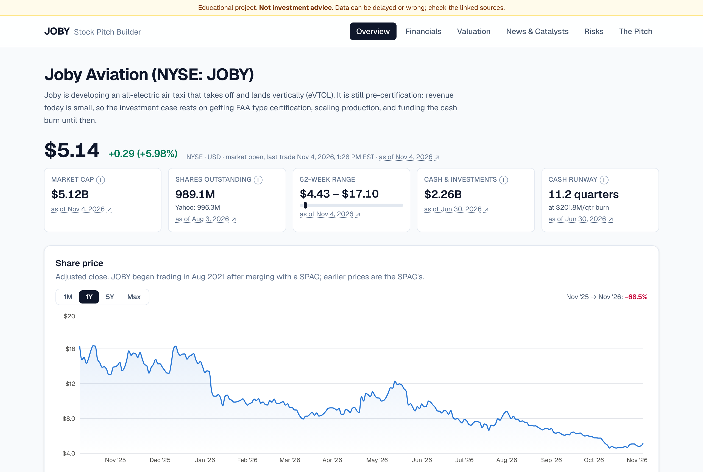
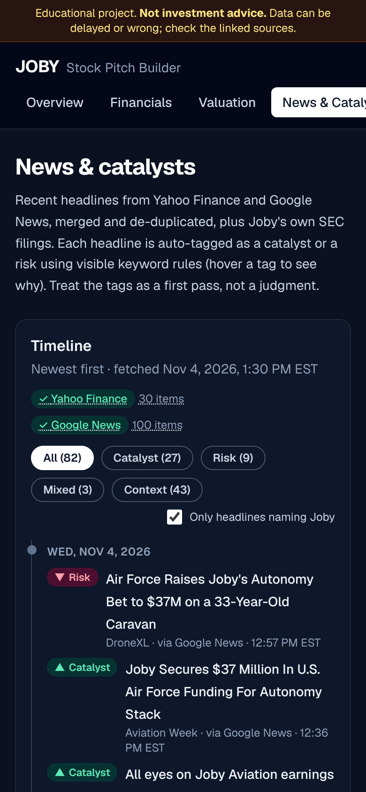

# JOBY Stock Pitch Builder

A web app that builds a complete, sourced investment pitch on **Joby Aviation (NYSE: JOBY)**, a pre-revenue eVTOL air-taxi company. It pulls live data from SEC EDGAR, Yahoo Finance and Google News, values the company with an interactive scenario DCF, and produces a one-page, printable pitch. Every number links to its source and date. If a source is down, the app says so instead of guessing.

> **Educational project, not investment advice.**


| Overview | Financials | Pitch | Mobile (dark) |
| --- | --- | --- | --- |
|  |  |  |  |

## Key findings (snapshot: Nov 4, 2026, before Q3 2026 results)

- **The price assumes a big fleet.** At ~$5.16, a reverse DCF holding my base-case economics fixed needs **~2,640 aircraft in service by 2035** vs. 800 in my base case. My probability-weighted value is **$4.19 (−19%) → SELL by a disclosed ±15% rule**. Price from [Yahoo Finance](https://finance.yahoo.com/quote/JOBY/); model on the Valuation page.
- **Cash buys ~2–3 years, but dilution continues.** $2.26B of cash and short-term investments against $202M of Q2 free-cash-flow burn is **~11 quarters of runway**, or ~9 pro forma for the ~$450M cash portion of the pending Resonant acquisition ([10-Q](https://www.sec.gov/Archives/edgar/data/1819848/000181984826000435/joby-20260630.htm), [8-K](https://www.sec.gov/Archives/edgar/data/1819848/000162828026055505/joby-20260808.htm)). Shares are **up 64% since Aug 2021**, and a $750M at-the-market program is in place ([424B5](https://www.sec.gov/Archives/edgar/data/1819848/000162828026055507/atm424b5.htm)).
- **Certification is close but not done.** Joby reports being ~75% through stage 4 of 5 of FAA type certification and targets first passengers in 2026 ([10-Q](https://www.sec.gov/Archives/edgar/data/1819848/000181984826000435/joby-20260630.htm)). The most valuable assumptions are **fleet at scale, margin, launch year and ramp speed**.

## Pages

1. **Overview**: snapshot in the company's own words, price chart (1M/1Y/5Y/Max), market cap, shares, 52-week range, runway.
2. **Financials**: income statement, balance sheet and cash flow from EDGAR XBRL (annual and quarterly), with charts of cash, burn and share count; runway and dilution math shown.
3. **Valuation**: editable bear/base/bull DCF, probability-weighted target, sensitivity grid, tornado, reverse DCF, live comps. See [docs/VALUATION.md](docs/VALUATION.md).
4. **News & Catalysts**: tagged news timeline, earnings date, dated milestones from filings, recent 8-Ks.
5. **Risks**: seven risk themes built from the latest 10-K Risk Factors, live data and headlines.
6. **The Pitch**: one page rendered from [`content/pitch.md`](content/pitch.md) (labeled DRAFT) beside a live check panel; print/PDF-ready.

## Run it

```bash
npm install && npm run dev
```

Open http://localhost:3000. No API keys are needed. Optionally set `SEC_USER_AGENT="Your Name you@example.com"` (see `.env.example`); the SEC asks automated clients to identify themselves.

```bash
npm test            # unit tests: DCF, probability weighting, runway, dilution, parsing
npm run lint
npm run build
```

Deploy: import the repo into Vercel (free tier) with no configuration. Set `SIMULATE_OUTAGE=all` (or `sec`, `yahoo`, `news`) locally to see how each page degrades when a source is down.

## Tech stack

Next.js 16 (App Router, Cache Components) · TypeScript · Tailwind CSS v4 · Recharts · `yahoo-finance2` · SEC EDGAR JSON APIs · Google News RSS (`fast-xml-parser`) · `react-markdown` · Vitest · Playwright (screenshots)

## Design choices

- **Primary sources first.** Financials come from SEC XBRL, not a data vendor. Quarterly cash flows are derived from year-to-date filings (Q2 = H1 − Q1) and flagged in the tables.
- **Caching.** Each data source is cached for about an hour (`use cache` + `cacheLife`), and pages stream data in at request time. Errors are never cached, and the build needs no network access.
- **Assumptions are mine and labeled.** Each one has a plain-language tooltip explaining why it matters. Live inputs (cash, debt, shares, burn, price) are sourced and cannot be edited.
- **Pending deals.** The Resonant acquisition is treated as value-neutral in the DCF and only reduces cash in the pro-forma runway. The adjustment is curated in `src/lib/adjustments.ts` with its 8-K link.
- **News tags** use visible keyword rules, so you can see (and argue with) why each headline is a catalyst or a risk.
- **Comps** are re-verified as listed on every refresh and converted to USD when a company reports in another currency.
- **Yahoo host fallback.** If one Yahoo host is blocked on your network, requests retry on Yahoo's equivalent host.
- Dark mode follows the OS; printing is always light.

## What I learned

- *The hardest assumption to defend in an interview was… because…*
- *Valuing a pre-revenue company differs from a profitable one in that…*
- *Reading Joby's 10-K risk factors changed my view on…*
- *If I rebuilt this, I would…*
- *The number that surprised me most was…*

## Repo map

```
src/lib/        data sources (edgar, yahoo, news, filings), valuation math, metrics
src/app/        one folder per page
content/pitch.md   your editable pitch
docs/VALUATION.md  plain-language valuation walkthrough
tests/          Vitest unit tests
scripts/screenshots.mjs  regenerates the README screenshots
```
